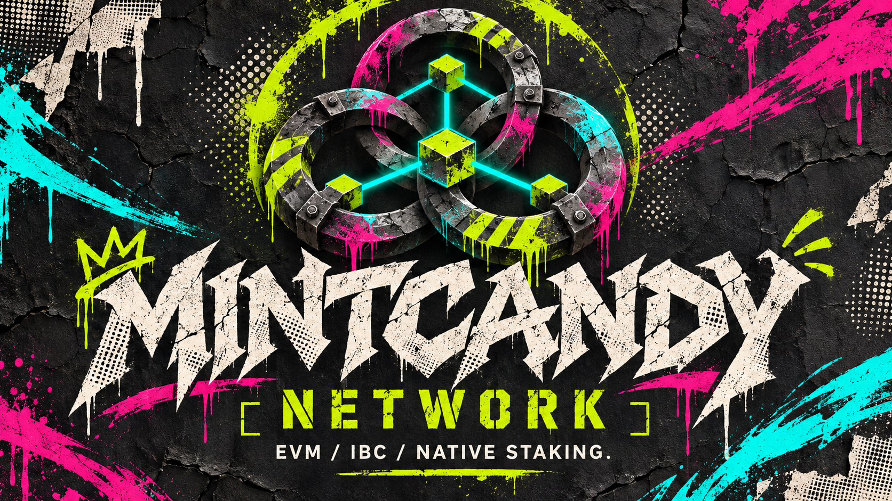

# MintCandy Network

Нативная монета: **MintCandy (MSP)**, 18 знаков, внутренний denom `del`.
[Название, metadata и техническая совместимость](network/docs/ru/NATIVE_TOKEN_IDENTITY.md).

Независимый интеграционный форк Decimal `go-smart-node`. Основная разработка
ведётся в [отдельном модуле `network/`](network/README.md): нода `mcnd`,
собственная сеть с новым genesis, EVM, нативный консенсус и IBC.

Версионные программные пакеты и их происхождение проверяются по
[GitHub Releases](https://github.com/maxwell2010/go-smart-node/releases) и
[инструкции OIDC/Sigstore](network/docs/ru/SOFTWARE_RELEASE_VERIFICATION.md).
Публичные genesis, состав операторов, распределение и адреса подключения
согласуются отдельно от выпуска программы.

## Две отдельные сборки

| Исходники | Назначение |
| --- | --- |
| [`network/`](network/README.md), `mcnd` | Новая MintCandy Network на SDK 0.53 / Cosmos EVM / IBC Go 10. В обычную сборку входят IBC/transfer; разрешённые нативные финансовые маршруты включаются проверенным профилем сети. |
| Корневой Go-модуль, `dscd` | Legacy-совместимость, исправления надёжности и отдельный исторический replay Decimal. Его экспериментальный IBC защищён тегом `experimental_ibc` и изолированными chain IDs. |

Утверждение «обычная сборка не подключает transfer» относится только к
legacy-модулю. Оно не описывает `mcnd`. Базы, genesis, зависимости и результаты
проверок этих сборок нельзя смешивать. Работающие Decimal-ноды не заменяйте
экспериментальным бинарником и не переносите их DB в новую сеть.

## Что реализуется в новой сети

- Нативный набор валидаторов и голосующая мощность по активному MSP,
  включая учтённые hold и обеспечение NFT; комиссия без инфляционных наград.
- Изолированные NFT-позиции, общий ручной/автоматический complete,
  DRC20-конвертация обеспечения с `minOut`, порционные штрафы и восстановление.
- Массовое делегирование: по умолчанию до 1000 нативных записей на валидатора.
  Награды начисляются из комиссий и автоматически выплачиваются страницами
  после интервала 120 блоков. Это не обещание выплаты всем за один блок.
- Оплата gas DRC20 с доступной публичной конвертацией резерва в нативный MSP;
  создание безрезервных токенов отдельно не даёт права оплачивать ими gas.
- ICS-20 и Hermes в изолированных сетях; голосование валидаторов и делегаторов.
  На одно предложение действует предел 256 голосующих адресов, поэтому
  1000 делегаций не означают неограниченный размер голосования.

Нативный финансовый профиль принимает разрешённые системные EVM-маршруты,
а не произвольные dApp-вызовы. SDK bank `MsgSend` поддерживается; обычный
Ethereum value CALL на EOA сейчас отклоняется. Совпадение ключа/адреса
кошелька не гарантирует стандартную кнопку native-перевода MetaMask.
[Точные границы кошельков, фабрики токенов и EVM](network/README.md#границы-текущего-профиля).

Мост к Decimal остаётся отдельным прототипом и не заявлен готовым для
реальных средств. DEX, инвестиционный vesting, собственный stablecoin,
DePIN и торговый MEV-сервис не входят в первый согласованный выпуск.

## Подтверждённые отдельные проверки

| Проверка | Ревизия и результат |
| --- | --- |
| Современный модуль и регрессии | [`2a5f4ff`, CI 44470608682](https://github.com/maxwell2010/go-smart-node/actions/runs/44470608682), success |
| DRC20 token-features | [`2a5f4ff`, CI 44470617638](https://github.com/maxwell2010/go-smart-node/actions/runs/44470617638), success |
| Подписанный тестовый пакет | [`2a5f4ff`, CI 44470745629](https://github.com/maxwell2010/go-smart-node/actions/runs/44470745629), success |
| Массовое делегирование 10/100/1000 | [`be7c179`, CI 44467813041](https://github.com/maxwell2010/go-smart-node/actions/runs/44467813041), success |

Это разные наборы проверок, частично разных ревизий. Они не подтверждают
все release gates. Подпись одноразовым ключом CI удостоверяет тестовый пакет,
а не утверждённого production-издателя. Текущее состояние process/Hermes и
оставшихся проверок смотрите в [статусе релиза](docs/RELEASE_STATUS.md).

## Установка и документация

- [Русское руководство оператора: зависимости, сервер, установка, пиры и диск](network/docs/ru/README.md).
- [Проверка подписанного пакета и установка без локальной Go-сборки](network/docs/ru/OPERATOR_LAUNCH.md).
- [Синхронизация, snapshots, pruning и журналы](network/docs/ru/SYNCHRONIZATION_AND_STORAGE.md).
- [Массовое делегирование, штрафы и автоматические награды](network/docs/ru/MASS_DELEGATION_AND_REWARDS.md).
- [CLI самоуправления валидатора](network/docs/ru/VALIDATOR_SELF_CONTROL.md) и [тестовый грейс-период](network/docs/ru/TEST_GRACE_PERIOD.md) - новые возможности feature-ветки, отсутствуют в опубликованном v1.0.0.
- [Проверки и ограничения](network/docs/ru/VERIFICATION_LIMITS.md).
- [Legacy-установка RU](docs/INSTALL.ru.md) / [EN](docs/INSTALL.en.md),
  [история интеграции и replay](docs/integration-progress.md),
  [проверки надёжности](docs/reliability-validation.md).

Все испытания запускаются на отдельных стендах. Сохраняйте upstream LICENSE
и существующие уведомления об исходниках.
